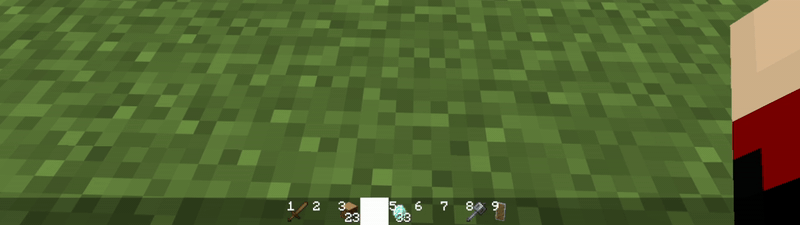
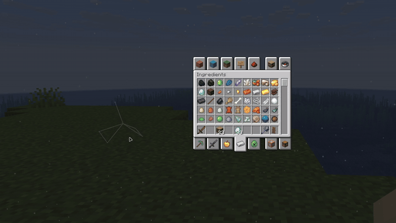
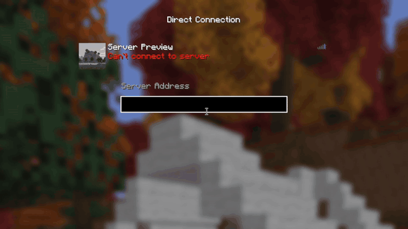

# REDACTION

REDACTION is a collection of small visual tweaks.

### Blackbar

A flat hotbar that runs the full width of your screen.

- Custom bar and highlight colors
- Slot numbers on your items
- The highlight slides between slots (Fabric versions)

### Inventory snow

Adds snow behind your inventory screen.

- Choose how many there are and what color they have
- Connect the ones near your cursor with lines

### And a few more

- A title screen button that rejoins the last server you played on
- A live server preview in Direct Connect while you type the address
- Custom FOV for your hand and held item

## Supported versions

- Minecraft 1.8.9 on Ornithe.
- Minecraft 1.21.1-26.3 on Fabric.

REDACTION needs [OneConfig](https://modrinth.com/mod/oneconfig) and Fabric Language Kotlin. The Fabric builds also need Fabric API.

## Support

- Report bugs and ask questions on the [Polyfrost Discord](https://polyfrost.org/discord).
- Check [Polyfrost Status](https://status.polyfrost.org/) if a Polyfrost service is down.
